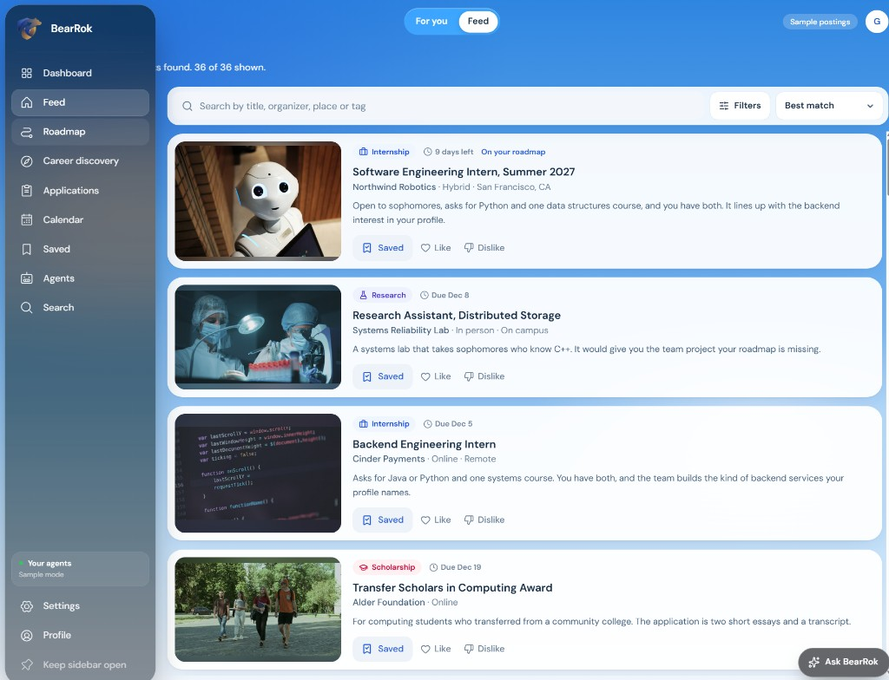
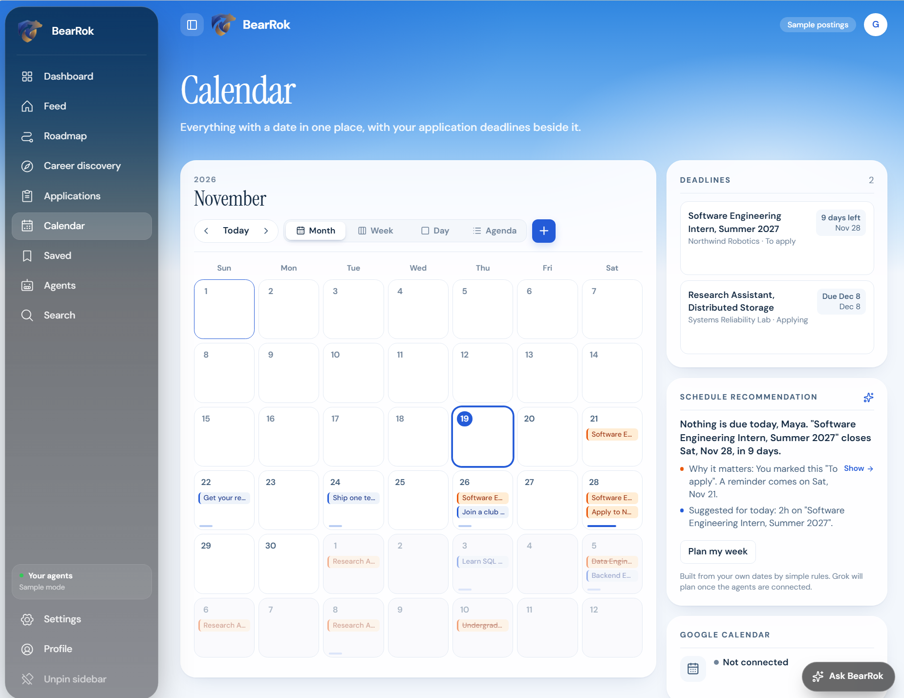
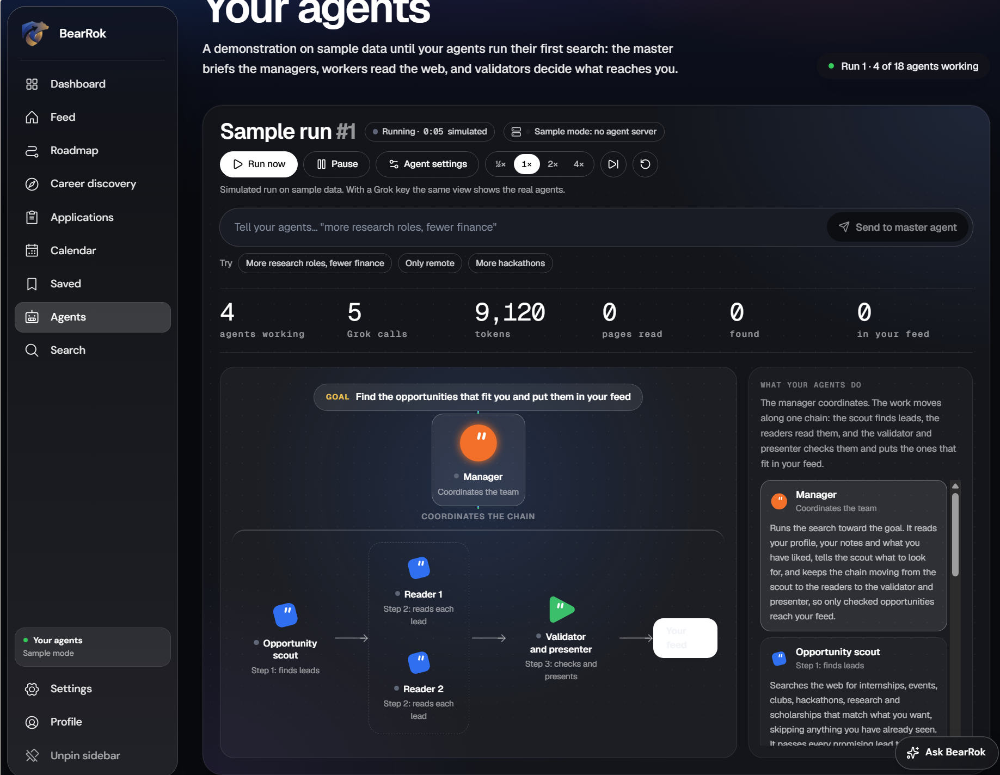
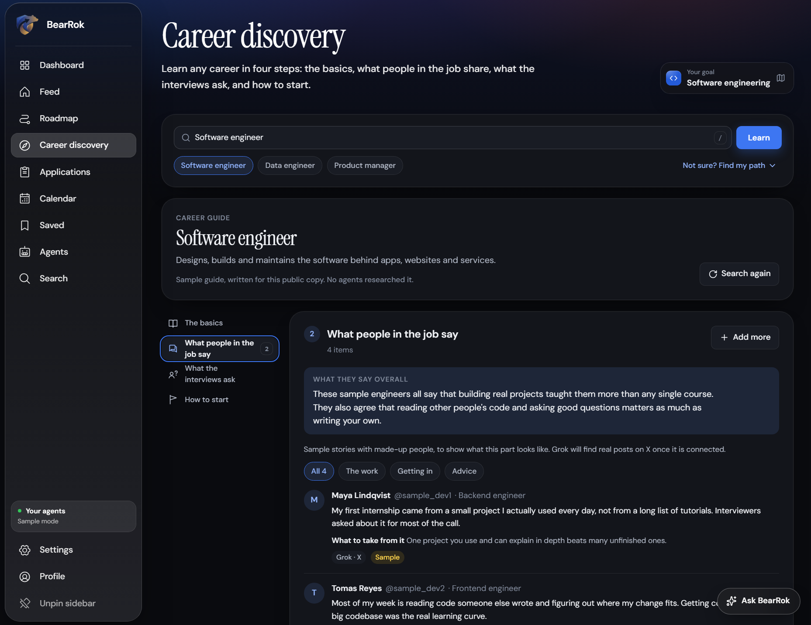
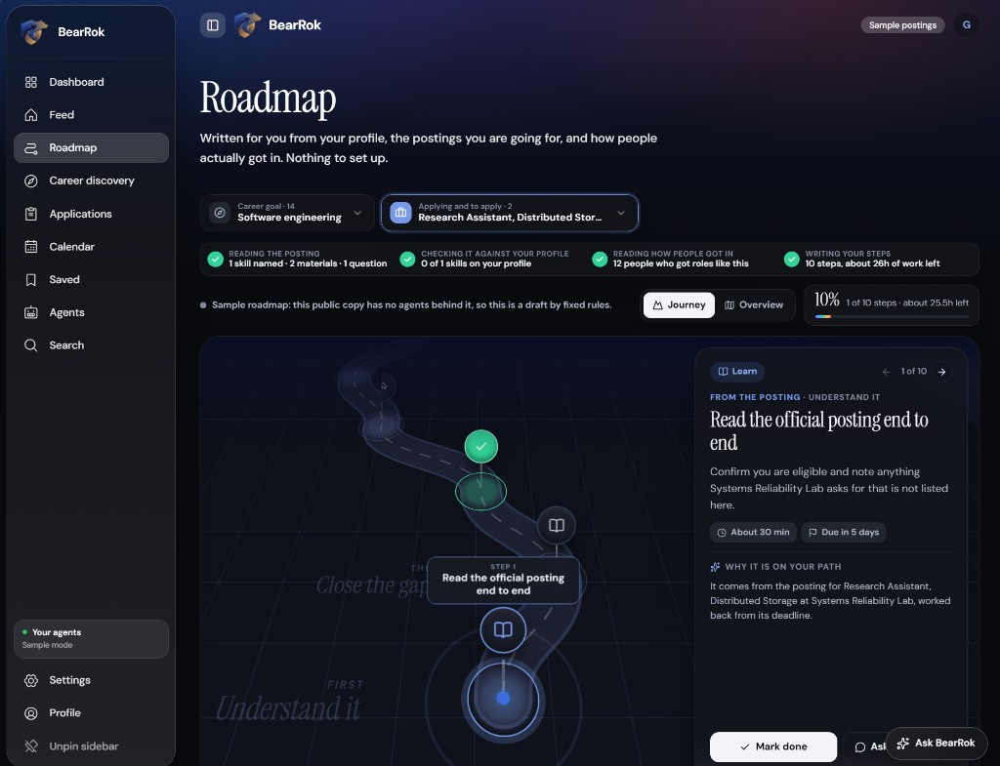
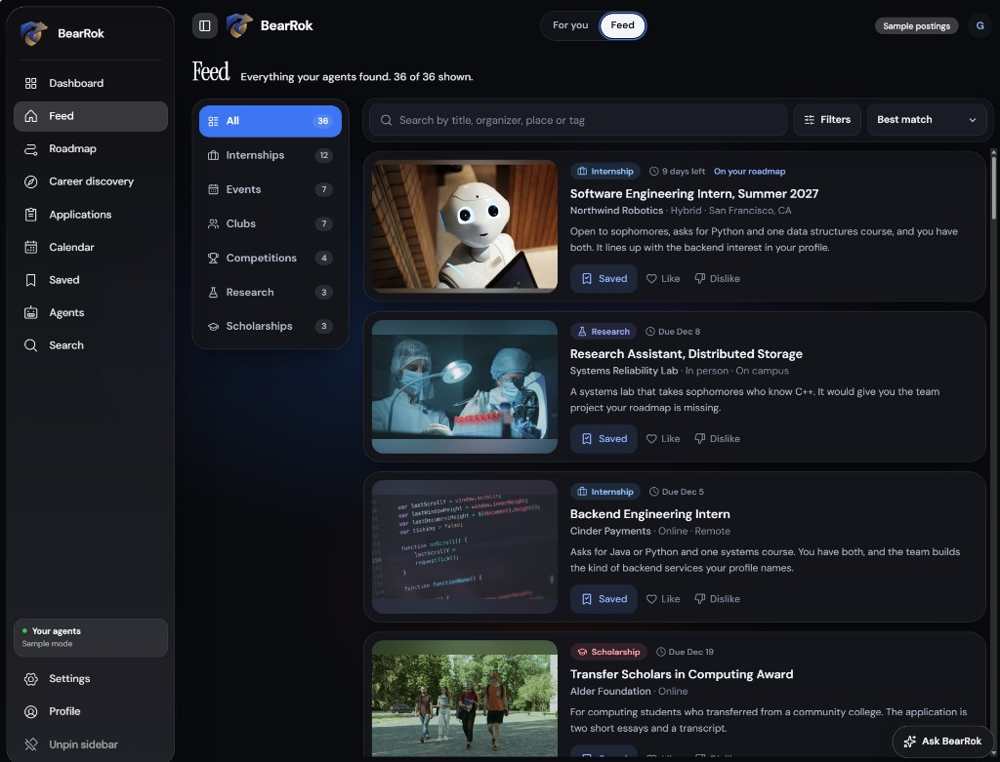

# BearRokk

BearRokk is the Simplify website after we changed it. Students ask in plain language and get opportunities that fit.

Simplify listed clubs, events, scholarships, and research openings and left the search to the student. That design had no AI tool. BearRokk solved that. A student writes what they want. A coordinating agent scopes the request, asks a follow-up only when the answer changes the search, and sends Grok workers out for leads. Validation keeps event dates separate from deadlines. The dashboard shows why a result fits, what is still unknown, and where the student acts. The hackathon demo covers clubs and events. Campus, class year, and student group are optional context. The student decides whether to join, register, or apply.

The pitch page in `site/` is the changed Simplify site, brought in from `website/dist` of [BearRok](https://github.com/samueldotrung03/BearRok). It walks one request through to listings the student can open. The repository also holds the discovery app, the dashboard in `dashboard/`, and the Grok agent service in `backend/`. The student asks in plain language. The service returns opportunities that fit.

Project start date: November 19, 2026.

**Start from a fresh clone.** You need Git and Python 3.

```bash
git clone https://github.com/samueldotrung03/BearRokk.git
cd BearRokk/site
python3 -m http.server 4174 --bind 127.0.0.1
```

Open http://127.0.0.1:4174/. The entry point is `site/index.html`. The title is “BearRok — Find your next thing.” Choose **Get Started**. The address becomes `#demo-preview`, the heading is “A quick look at BearRok,” and the page includes `assets/demo-walkthrough.webm` with playback controls. The video is the student feed after the change. **Download now!** stays disabled, and **Sign In** says “Not available yet.”





*Calendar.*

## The problem

Simplify had no AI tool. A first-year student looking for a club, hackathon, scholarship, or research opening had to check Luma, Devpost, school posts, and Reddit. The announcement, the organizer’s instructions, and the deadline sat on different pages. The student pieced together what was open, when to act, and whether it fit. That search took the time, and a mixed-up date or a missed deadline made the result hard to trust.

## Discovery app

The student-facing discovery screen is the part of Simplify we changed. It opens on For you, then Feed. The student asks in plain language and gets opportunities that fit. Saves, likes, and dislikes stay in this browser.

```bash
npm install
npm run dev
```

Open the printed local URL. `npm run build` typechecks and writes `dist/`.

## Backend

The AI tool lives in `backend/`. It is the Grok agent service from [BearRok](https://github.com/samueldotrung03/BearRok) at commit `e5ffdae`. A typed request goes to `POST /api/students/:id/runs` as `{ "request": "..." }`. A club near Berkeley and an online hackathon stay separate searches. The discovery screens read the opportunities in `src/data/opportunities.ts` and show the ones that fit the request.

```bash
cd backend
npm install
npm run typecheck
npm test
npm run dev
```

`XAI_API_KEY` runs the agents on Grok. Details and the rest of the run path are in [`backend/README.md`](backend/README.md).

## How BearRokk solves it

We changed Simplify so this request works from the student’s own words.

**Request:** “I want to join a beginner-friendly coding club and attend an online hackathon next month.”

On the pitch page the wording is “A beginner-friendly coding club and an online hackathon next month.” “Online” describes the hackathon. The follow-up is “Should the club also meet online, or would you prefer one near your campus?”

The event is Cosmo Hacks 2026, reviewed November 18, 2026. The Check panel shows an event window of Dec 19, 2026 – Jan 18, 2027, and project submissions ending Jan 18, 2027 · 4 PM CST. The registration deadline stays unknown. The May 10, 2027 row is interface data, and the organizer deadline remains unknown.


Opening **Cosmo Hacks 2026 · source notes** fills the dialog from `openSourceNotes` in [`site/app.js`](site/app.js). The dialog links to the [official event website](https://www.cosmohacks.com/) and the [Devpost listing](https://cosmohacks.devpost.com/). January 18 is the event and project-submission end. The review established no separate registration cutoff. The student uses those pages and decides whether to register.

The club that fits the same request is CodePath Spring 2027 in `src/data/opportunities.ts`. The card says how to join and leaves the enrollment deadline unknown. [`AGENTS.md`](AGENTS.md) names the workers Club Scout and Event Scout.

Shared card fields: title, type, organizer, source URL, join or registration URL when the source has one, location or online format, fit explanation, and last-checked time. A club adds meeting schedule and membership intake. An event adds start time, time zone, and registration deadline. Missing fields stay visibly unknown.

Résumé reading personalizes later searches. This visit runs from the student’s request alone.

## Why you can trust it

The change is the AI tool Simplify lacked. A student asks in plain language and receives opportunities that fit, with the organizer link and any unknown left visible.

| What holds | Where it is enforced | What exercises it |
|---|---|---|
| A missing registration deadline stays “Registration deadline unknown.” January 18 is the event and submission end. | `openSourceNotes` in [`site/app.js`](site/app.js) | [`site/check-demo.cjs`](site/check-demo.cjs) asserts the dialog text |
| The May 10, 2027 date is interface data. The organizer deadline stays unknown. | The same source-notes dialog, and the Check panel copy in [`site/index.html`](site/index.html) | The same check matches the May 10 sentence in the dialog |
| Old dashboard addresses open the Demo. | `route` in [`site/app.js`](site/app.js) sends `#demo`, `#dashboard`, `#search-form`, and the other retired hashes in the check to `#demo-preview` | [`site/check-demo.cjs`](site/check-demo.cjs) |
| Download stays unavailable. | The disabled **Download now!** button in [`site/index.html`](site/index.html) | The same check |
| The request, the review, and the walkthrough are labeled on the page. | The labels in [`site/index.html`](site/index.html) | Visible on the page. The check locks the May 10 sentence |

[`AGENTS.md`](AGENTS.md) adds the matching data rules: keep event dates separate from deadlines, leave unknowns explicit, and apply “online” only to the opportunity it describes.

## What one student visit does

The visit is the request above, Cosmo Hacks, and the CodePath card.

**What goes in.** “I want to join a beginner-friendly coding club and attend an online hackathon next month.”

**What the system decides.**

- “Online” describes the hackathon. The club’s meeting format is the follow-up question.
- The event is Cosmo Hacks 2026.
- The event window and the Jan 18, 2027 · 4 PM CST submission end are known.
- The registration deadline is unknown. May 10, 2027 is interface data.
- The notes cite the official site for organizer information on online format, beginner participation, theme, eligibility, and the event window, and the Devpost listing for event and submission details.
- The club is CodePath Spring 2027. The enrollment deadline is unknown.

**What needs the student.** Read the source notes, open the organizer pages, and decide whether to register. Answer the club-format question so that constraint is applied.

**What comes out.** An event card and a club card that fit the request. Both carry the organizer link, why the result fits, and the last-checked time. The student joins or registers from the organizer’s page.

## A look inside

The Feed image above is the list after the change. Cards show the type, the title, the organizer, and a date. Cosmo Hacks is the event in the source notes. CodePath is the club in the discovery data.



*Your agents, sample run.*



*Career discovery, software engineer.*



*Roadmap.*



*Dark Feed with the category sidebar.*

On Home, **Meet the mechanism** (`#workflow`) scrolls to the roles that replaced Simplify’s empty search: run triggers, a master, four search managers, scouts, extractors, validators, application readers, a presentation manager, the student feed, and memory. **Explore the technology** (`#technology`) lists the marks for the pitch; icon sources are in [`site/assets/marks/SOURCES.md`](site/assets/marks/SOURCES.md).

**Demo** (`#demo-preview`) is the walkthrough. Under the video, the page explains another plain-language request: “I’m a first-year student looking for paid software internships in Berkeley or remote. No events.” That request returns internships that fit and leaves events out.

**About Us** (`#about-us`) names Brian Huang, Gia Khanh Trieu, and Samuel Do.

| Piece | Role |
|---|---|
| [`site/index.html`](site/index.html) | The changed Simplify pitch: request, Cosmo Hacks, Feed image, Demo, and About |
| [`site/app.js`](site/app.js) | Hash routing, source-notes dialog, capability deck, agent-diagram motion |
| [`site/check-demo.cjs`](site/check-demo.cjs) | Local check of routing, source-note wording, and the deck |
| [`AGENTS.md`](AGENTS.md) | Contributor rules for evidence, unknowns, and the Club Scout / Event Scout handoff |
| [`backend/`](backend/README.md) | The AI tool Simplify lacked: the Grok agent service |

## Try it

**Pitch page.** Easiest path. Prerequisite: Git and Python 3.

```bash
git clone https://github.com/samueldotrung03/BearRokk.git
cd BearRokk/site
python3 -m http.server 4174 --bind 127.0.0.1
```

Open http://127.0.0.1:4174/.

1. Home shows the headline and the Feed image.
2. **Get Started** opens `#demo-preview` and the walkthrough video.
3. Return Home and open **Cosmo Hacks 2026 · source notes**. The dialog says “Registration deadline unknown.”
4. **About Us** opens `#about-us`.

`#home`, `#demo-preview`, and `#about-us` are the three views. `#workflow` stays on Home and scrolls to the agent diagram. `#demo`, `#dashboard`, and `#search-form` open `#demo-preview`.

**Local check.** Prerequisite: Node.js.

```bash
node site/check-demo.cjs
```

Run it from the repository root. Exit 0 means the checks in that file passed. Details are in [Tests and proofs](#tests-and-proofs).

## How it works

The student asks in plain language. Simplify stopped at a list. BearRokk answers with opportunities that fit.

The pitch page, for the Cosmo visit, serves the request, the follow-up, and the source notes. `route` in [`site/app.js`](site/app.js) chooses Home, Demo, or About from the hash. The Check panel is HTML. The source-notes dialog is written by `openSourceNotes` when the student clicks. The diagram on the page matches [`backend/AGENT_SYSTEM.md`](backend/AGENT_SYSTEM.md). The earlier prototype copy is [`backend/AGENT_SYSTEM.md` at commit `1b9d2f9`](https://github.com/samueldotrung03/BearRok/blob/1b9d2f965b93b600dc6afa7775732e22bd875ee1/backend/AGENT_SYSTEM.md).

`backend/` is the AI tool. The coordinating agent reads the student’s words. Grok workers search. Validation checks the organizer page. The dashboard presents the cards. `XAI_API_KEY` sends those calls to Grok. [`AGENTS.md`](AGENTS.md) names the coordinator a manager Grok Bot and the workers Club Scout and Event Scout.

| Responsibility | Who decides | What changes | What the next stage receives |
|---|---|---|---|
| Coordinate the request | Coordinating agent, using the student’s wording | Opportunity types, interests, date range, and any location or eligibility constraint are identified. Requirements and preferences are separated. | A brief per search worker. The original wording stays available. |
| Discover candidates | Grok workers, using Grok web search | Each worker returns leads for its opportunity type. | Candidate URL, organizer if known, and the source text behind each relevant claim. |
| Validate | Validation, against the organizer or official listing | Open or closed status is checked, dates are separated from deadlines, and repeat announcements are merged. Conflicts stay uncertain. | One record per opportunity with an organizer link, last-checked time, and evidence for the displayed details. |
| Store and present | Database, then the dashboard | Search scope, run status, validated listings, and sources are stored. | Cards showing why a result fits, what is unknown, and where the student can act. Each result set identifies its origin. |

Candidate sources: public school or club pages, Luma, Devpost, and Reddit. X search runs when it is relevant. The default search is the web.

## Tests and proofs

From the repository root:

```bash
node site/check-demo.cjs
```

Prerequisite: Node.js. The script loads `site/app.js` and reads `site/index.html`, `site/styles.css`, and `site/assets/bearrok-mark.svg`.

On a passing run it prints six `Passed:` lines and exits 0. Those lines cover:

- Retired links resolve to the Demo, and Home, About, the video element, and the source notes behave as the script asserts.
- The capability deck selects a category by click, keyboard, and swipe, and keeps that state on the control.
- A stationary pointer does not change the selected card.
- The deck markup keeps the fixed category order.
- Desktop cards share a height, and the mobile faces use the horizontal layout in the stylesheet.
- Selecting the last mobile card scrolls the card lane and leaves the page scroll alone.

A run on November 19, 2026, against commit `c6cdeb9`, printed those six lines and exited 0.

**What the demo proves.**

- **Grok Use.** One student constraint travels from the coordinator’s brief to a worker query and a source-backed result.
- **Student Use.** A first-year student chooses a club or event from the results, explains the next step, tells a meeting or event time from a deadline, and finds the organizer’s instructions.
- **Validation.** A missing deadline stays unknown. Cosmo Hacks is that case: the event window is known, and the registration deadline is unknown.

## Repository layout

```
.
├── AGENTS.md                 # Evidence, unknowns, and Club Scout / Event Scout rules
├── README.md                 # This file
├── backend/                  # The AI tool: Grok agent service
├── dashboard/                # Dashboard and Electron app
├── src/                      # Discovery app and the opportunities that fit a request
├── GrokBot-session/          # GrokBot session folder
│   ├── cursor-session-export.md
│   ├── landing-page-chat.md
│   ├── opportunity-discovery-chat.md
│   └── project-session.md
└── site/                     # Changed Simplify pitch page
    ├── index.html            # Home, Demo, and About
    ├── app.js                # Routing, source notes, deck, diagram motion
    ├── styles.css
    ├── check-demo.cjs        # Node check described above
    └── assets/               # Feed image, walkthrough video, logo, technology marks
```

## Roadmap

**Shipped.**

- The change from Simplify. The earlier site had no AI tool. BearRokk answers a plain-language request with opportunities that fit.
- The written plan, project start date November 19, 2026.
- Contributor rules in [`AGENTS.md`](AGENTS.md).
- The pitch page, including Cosmo Hacks, the Feed image, and the walkthrough video.
- The discovery app, with the opportunities in `src/data/opportunities.ts`.
- The dashboard in `dashboard/`, including the Electron app.
- The Grok agent service in `backend/`.
- Public chat exports in the GrokBot session folder, [`GrokBot-session/`](GrokBot-session/).

The event is **Thursday, November 19, 2026**. Grok account access is at **2 p.m.** Pacific. The windows below are the work that landed the change.

| When | Milestone | Evidence to move on |
|---|---|---|
| Thu, Nov 19 · kickoff | The team agreed on the demo query, the card fields, and the handoff between the pitch and the dashboard. | Everyone describes the same student journey. The club page and the event page are Cosmo Hacks and CodePath. |
| Thu, Nov 19 · before access | The discovery path, the dashboard, and the pitch walkthrough use the checked listings. | The walkthrough runs from the pitch through both cards to the organizer links. A missing deadline stays unknown. |
| Around 2 p.m. · account handover | The account includes API credentials, search-tool access, and a usable allowance. | One worker returns a candidate and its source. |
| After access | One live student request runs through discovery, validation, storage, and display. | A judge follows a displayed claim back to the organizer. |
| Before submission | The timed pitch runs on that path. | The walkthrough shows the plain-language request and the opportunities that fit. |

### Open decisions

The product decision is closed. Simplify had no AI tool. BearRokk replaced that website. Students ask in plain language and get opportunities that fit.

| Planning detail | Confirmed value |
|---|---|
| Product | BearRokk, the changed Simplify website |
| AI tool | Grok agent service in `backend/` |
| Student action | Ask in plain language |
| Result | Opportunities that fit, with the organizer’s next step |
| Demo query | A beginner-friendly coding club and an online hackathon next month |
| Event and club | Cosmo Hacks 2026 and CodePath Spring 2027 |

## Read next

| Document | Question it answers |
|---|---|
| [`AGENTS.md`](AGENTS.md) | Which data rules and handoff names contributors follow, and which submission artifacts are required |
| [`site/index.html`](site/index.html) | What the pitch page shows for the request, Cosmo Hacks, and the Demo |
| [`site/app.js`](site/app.js) | How hash routing and the source-notes dialog work |
| [`site/check-demo.cjs`](site/check-demo.cjs) | Which sentences and routes the Node check locks |
| [`site/assets/marks/SOURCES.md`](site/assets/marks/SOURCES.md) | Where the technology marks come from |
| [`backend/README.md`](backend/README.md) | How the AI tool runs a plain-language request |
| [`dashboard/README.md`](dashboard/README.md) | How the dashboard shows the opportunities that fit |
| [`GrokBot-session/cursor-session-export.md`](GrokBot-session/cursor-session-export.md) | Cursor cloud-agent transcript for the BearRok backend work |
| [`GrokBot-session/opportunity-discovery-chat.md`](GrokBot-session/opportunity-discovery-chat.md) | Visible chat for the student discovery app |
| [`GrokBot-session/landing-page-chat.md`](GrokBot-session/landing-page-chat.md) | Visible chat for the landing page and contributor rules |
| [`GrokBot-session/project-session.md`](GrokBot-session/project-session.md) | Visible chat for this Project |
| [Prototype `backend/AGENT_SYSTEM.md`](https://github.com/samueldotrung03/BearRok/blob/1b9d2f965b93b600dc6afa7775732e22bd875ee1/backend/AGENT_SYSTEM.md) | How the BearRok prototype describes the agent system |

The product brief, including the November 18 clarification, and the *Student Opportunity Platform: Brainstorming & Architecture Summary* sit with the team. The *Luyten* README supplied the structure for the student problem, one journey, responsibilities, evidence, and milestones.
