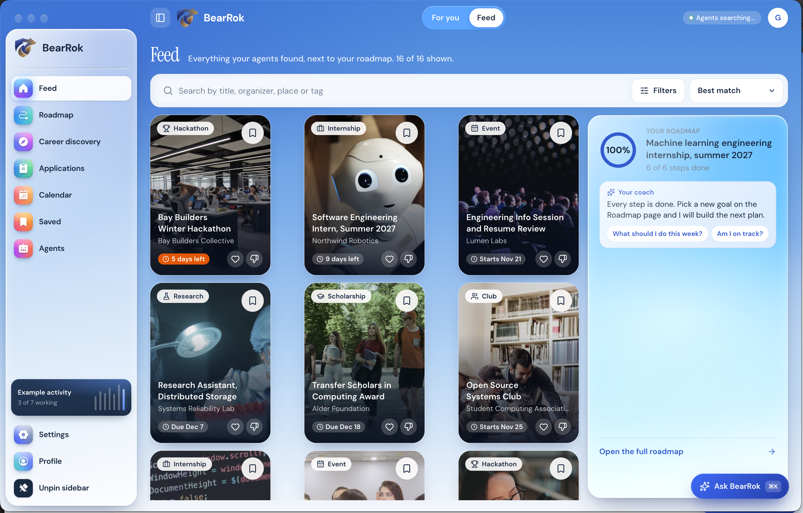
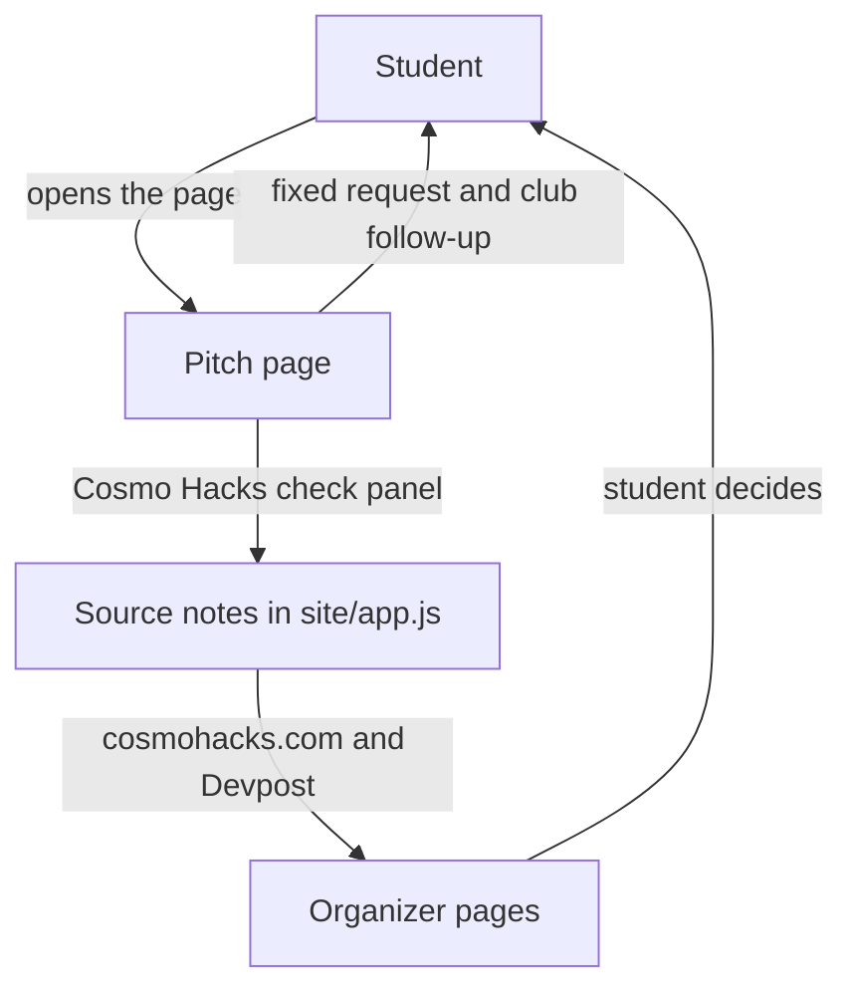

# BearRokk

BearRokk helps a student turn one request into listings they can check and act on.

The student says what they want. A coordinating agent is meant to scope that request, ask a follow-up only when the answer would change the search, and send Grok workers out for leads. Validation keeps event dates separate from deadlines, and the dashboard is meant to show why a result fits, what is still unknown, and where the student can act. The hackathon demo covers clubs and events. Campus, class year, and student group are optional context. The student decides whether to join, register, or apply.

What you can open today is the BearRok pitch page in `site/`. It is the landing page imported from `website/dist` of the earlier [BearRok](https://github.com/samueldotrung03/BearRok) prototype. The page walks a fixed request through a prepared example. Its agent diagram is labeled as a simulated catalog, and the page says live Grok remains unverified.

Project start date: November 19, 2026.

**Start from a fresh clone.** You need Git and Python 3. No API key, database, or package install.

```bash
git clone https://github.com/samueldotrung03/BearRokk.git
cd BearRokk/site
python3 -m http.server 4174 --bind 127.0.0.1
```

Open http://127.0.0.1:4174/. The entry point is `site/index.html`. The title is “BearRok — Find your next thing.” Choose **Get Started**. The address becomes `#demo-preview`, the heading is “A quick look at BearRok,” and the page includes `assets/demo-walkthrough.webm` with playback controls. The page says that video is a prepared student feed. **Download now!** stays disabled, and **Sign In** says “Not available yet.”



## The problem

A first-year student looking for a club, hackathon, scholarship, or research opening has to check Luma, Devpost, school posts, and Reddit. The announcement, the organizer’s instructions, and the deadline can sit on different pages. The student has to piece together what is open, when to act, and whether it fits their interests. That search takes the time, and a mixed-up date or a missed deadline is what makes the result hard to trust.

## Discovery app

The student-facing discovery screen lives in this repository. It opens on For you, then Feed, using prepared examples. Saves, likes, and dislikes stay in this browser.

```bash
npm install
npm run dev
```

Open the printed local URL. `npm run build` typechecks and writes `dist/`.

## Backend

The search service lives in `backend/`. It is imported from the earlier [BearRok](https://github.com/samueldotrung03/BearRok) prototype (commit `e5ffdae`). A typed request goes to `POST /api/students/:id/runs` as `{ "request": "..." }`. A club near Berkeley and an online hackathon stay separate searches. The discovery screens above still use the prepared examples in `src/data/opportunities.ts`. They do not call this service yet.

```bash
cd backend
npm install
npm run typecheck
npm test
npm run dev
```

Without `XAI_API_KEY` the agents run on the labeled simulated catalog. Details and the rest of the run path are in [`backend/README.md`](backend/README.md).

## How BearRokk solves it

The same request is the one the plan rehearses and the one the pitch page already shows.

**Request:** “I want to join a beginner-friendly coding club and attend an online hackathon next month.”

On the pitch page the wording is shortened to “A beginner-friendly coding club and an online hackathon next month.” The page labels that panel “PREPARED REQUEST / WEBSITE EXAMPLE” and says the walkthrough uses a fixed keyword filter. “Online” describes the hackathon. The fixed follow-up is “Should the club also meet online, or would you prefer one near your campus?”

The prepared event on the page is Cosmo Hacks 2026, reviewed November 18, 2026 for this pitch. The Check panel shows an event window of Dec 19, 2026 – Jan 18, 2027, and project submissions ending Jan 18, 2027 · 4 PM CST. A May 10, 2027 row is marked “Registration deadline · sample” and “Demo date only · organizer deadline remains unknown.”



Opening **Cosmo Hacks 2026 · source notes** fills the dialog from `openSourceNotes` in [`site/app.js`](site/app.js). The dialog links to the [official event website](https://www.cosmohacks.com/) and the [Devpost listing](https://cosmohacks.devpost.com/). It states that January 18 is the event and project-submission end, and that the review did not establish a separate registration cutoff. The student uses those pages and decides whether to register.

A named club card, with a meeting schedule and a way to join, is still to be chosen. The contributor rules in [`AGENTS.md`](AGENTS.md) call the two planned workers Club Scout and Event Scout. They are not running in this repository.

Shared card fields for that later handoff: title, type, organizer, source URL, join or registration URL when the source has one, location or online format, fit explanation, and last-checked time. A club adds meeting schedule and membership intake. An event adds start time, time zone, and registration deadline. Missing fields stay visibly unknown. The database engine, hosting, and provider configuration are still open.

The team has skills for reading and evaluating résumés. Those could personalize later searches. This demo works from the student’s request alone. Résumé integration, review of extracted details, and permission to store those details are open decisions.

## Why you can trust it

These are the checks this repository actually enforces. Live search is outside them. The pitch page caption on the agent diagram says “simulated catalog and in-memory state; live Grok remains unverified.”

| What holds | Where it is enforced | What exercises it |
|---|---|---|
| A missing registration deadline stays “Registration deadline unknown.” January 18 is the event and submission end. | `openSourceNotes` in [`site/app.js`](site/app.js) | [`site/check-demo.cjs`](site/check-demo.cjs) asserts the dialog text |
| The May 10, 2027 date is sample UI data. | The same source-notes dialog, and the Check panel copy in [`site/index.html`](site/index.html) | The same check matches `May 10` with `sample UI data` |
| Old dashboard addresses open the prepared Demo. | `route` in [`site/app.js`](site/app.js) sends `#demo`, `#dashboard`, `#search-form`, and the other retired hashes in the check to `#demo-preview` | [`site/check-demo.cjs`](site/check-demo.cjs) |
| Download stays unavailable. | The disabled **Download now!** button in [`site/index.html`](site/index.html) | The same check |
| Prepared copy is labeled on the page. | “PREPARED REQUEST / WEBSITE EXAMPLE,” “PREPARED EXAMPLE / SOURCE REVIEW NOV 18,” and “PREPARED WALKTHROUGH” in [`site/index.html`](site/index.html) | Visible on the page. The check locks the sample-date sentence, not every label |

[`AGENTS.md`](AGENTS.md) adds the matching data rules: label prepared examples, keep event dates separate from deadlines, leave unknowns explicit, and apply “online” only to the opportunity it describes.

## What one student visit does

The visit uses the request above and the Cosmo Hacks records already in the pitch page. There is no separate seed file.

**What goes in.** “I want to join a beginner-friendly coding club and attend an online hackathon next month.” The page shows the shortened sentence and does not take a new request.

**What the page decides, from the November 18 review.**

- “Online” describes the hackathon. The club’s meeting format is the follow-up question.
- The event shown is Cosmo Hacks 2026.
- The event window and the Jan 18, 2027 · 4 PM CST submission end are known.
- The registration deadline is unknown. The May 10, 2027 date is sample UI data.
- The notes cite the official site for organizer information on online format, beginner participation, theme, eligibility, and the event window, and the Devpost listing for event and submission details.

**What needs the student.** Read the source notes, open the organizer pages, and decide whether to register. Answer the club-format question only as a reading of the fixed follow-up. The page does not store the answer.

**What comes out.** A prepared event example with the dates above, the unknown deadline, and the two organizer links. A club listing for this request is not in the repository yet.

## A look inside

The Feed image above is the preview on Home. Notice the card types and the dates on the cards. The page treats that image as a prepared Feed view. The Cosmo Hacks notes are a different example. The comment above `openSourceNotes` says those notes are not about the Feed screenshot.

On Home, **Meet the mechanism** (`#workflow`) scrolls to the illustrated roles: run triggers, a master, four search managers, scouts, extractors, validators, application readers, a presentation manager, the student feed, and memory. The caption says the catalog is simulated. **Explore the technology** (`#technology`) lists the marks for the pitch; icon sources are in [`site/assets/marks/SOURCES.md`](site/assets/marks/SOURCES.md).

**Demo** (`#demo-preview`) is the prepared walkthrough. Under the video, the page explains a different sample request: “I’m a first-year student looking for paid software internships in Berkeley or remote. No events.” That section is the prototype’s agent walkthrough. It is not the club-and-hackathon visit.

**About Us** (`#about-us`) names Brian Huang, Gia Khanh Trieu, and Samuel Do. Those names are the About page. They are not assigned to the A, B, and C roles in the plan below.

| Piece | Role |
|---|---|
| [`site/index.html`](site/index.html) | Pitch copy, prepared Cosmo panel, Feed image, Demo and About views |
| [`site/app.js`](site/app.js) | Hash routing, source-notes dialog, capability deck, agent-diagram motion |
| [`site/check-demo.cjs`](site/check-demo.cjs) | Local check of routing, source-note wording, and the deck |
| [`AGENTS.md`](AGENTS.md) | Contributor rules for evidence, unknowns, and the Club Scout / Event Scout handoff |

## Try it

**Pitch page.** Easiest path. Prerequisite: Git and Python 3. No credentials. The page is static files. The request, the follow-up, and the Cosmo card are fixed content. The agent diagram is the simulated catalog described on the page. Sign-in, download, and live Grok search are not part of this path.

```bash
git clone https://github.com/samueldotrung03/BearRokk.git
cd BearRokk/site
python3 -m http.server 4174 --bind 127.0.0.1
```

Open http://127.0.0.1:4174/.

1. Home shows the headline and the Feed image.
2. **Get Started** opens `#demo-preview` and the walkthrough video.
3. Return Home and open **Cosmo Hacks 2026 · source notes**. The dialog should say “Registration deadline unknown.”
4. **About Us** opens `#about-us`.

`#home`, `#demo-preview`, and `#about-us` are the three views. `#workflow` stays on Home and scrolls to the agent diagram. `#demo`, `#dashboard`, and `#search-form` are sent to `#demo-preview`.

**Local check.** Prerequisite: Node.js. No server and no credentials.

```bash
node site/check-demo.cjs
```

Run it from the repository root. Exit 0 means the checks in that file passed. Details are in [Tests and proofs](#tests-and-proofs).

## How it works

Two descriptions live side by side.

The pitch page, for the Cosmo visit, is static. `route` in [`site/app.js`](site/app.js) chooses Home, Demo, or About from the hash. The Check panel is HTML. The source-notes dialog is a string written by `openSourceNotes` when the student clicks. Nothing in this repository writes a database row or calls Grok. The diagram links to the prototype note [`backend/AGENT_SYSTEM.md`](https://github.com/samueldotrung03/BearRok/blob/1b9d2f965b93b600dc6afa7775732e22bd875ee1/backend/AGENT_SYSTEM.md) at commit `1b9d2f9`. That backend is not in this repository.

The hackathon handoff the plan still uses is the table below. [`AGENTS.md`](AGENTS.md) names the coordinator a manager Grok Bot and the workers Club Scout and Event Scout. Building that path is still ahead of this tree.

| Responsibility | Who decides | What changes | What the next stage receives |
|---|---|---|---|
| Coordinate the request | Coordinating agent, using the student’s wording | Opportunity types, interests, date range, and any location or eligibility constraint are identified. Requirements and preferences are separated. | A brief per search worker. The original wording stays available. |
| Discover candidates | Grok workers, using Grok web search | Each worker returns leads for its opportunity type. | Candidate URL, organizer if known, and the source text behind each relevant claim. |
| Validate | Validation, against the organizer or official listing | Open or closed status is checked, dates are separated from deadlines, and repeat announcements are merged. Conflicts stay uncertain. | One record per opportunity with an organizer link, last-checked time, and evidence for the displayed details. |
| Store and present | Database, then the dashboard | Search scope, run status, validated listings, and sources are stored. | Cards showing why a result fits, what is unknown, and where the student can act. Each result set identifies its origin. |

Candidate sources named for discovery: public school or club pages, Luma, Devpost, and Reddit. X search is in the plan when it is relevant and available. The pitch walkthrough says the default is web search, and that X search is optional. Coverage of any individual site still needs a live check.

## Tests and proofs

From the repository root:

```bash
node site/check-demo.cjs
```

Prerequisite: Node.js. The script does not start the web server, a database, or Grok. It loads `site/app.js` in a small stand-in for the browser and reads `site/index.html`, `site/styles.css`, and `site/assets/bearrok-mark.svg`.

On a passing run it prints six `Passed:` lines and exits 0. Those lines cover:

- Retired links resolve to the prepared Demo, and Home, About, the video element, and the source notes behave as the script asserts.
- The capability deck selects a category by click, keyboard, and swipe, and keeps that state on the control.
- A stationary pointer does not change the selected card.
- The deck markup keeps the fixed category order.
- Desktop cards share a height, and the mobile faces use the horizontal layout in the stylesheet.
- Selecting the last mobile card scrolls the card lane and leaves the page scroll alone.

A run on November 19, 2026, against commit `c6cdeb9`, printed those six lines and exited 0. This README does not change `site/`, so the same command applies.

There is no separate unit, integration, or browser end-to-end suite, and no CI workflow. The rehearsal checks below are still manual.

**What the demo should prove.**

- **Grok Use.** Follow one student constraint from the coordinator’s brief to a worker query and a source-backed result. If the team receives only an interactive login, show a manual Grok search separately and identify the dashboard examples as prepared.
- **Student Use.** A first-year student chooses a club or event from the results and explains the next step, including the difference between a meeting or event time and a deadline, and finds the organizer’s instructions.
- **Validation.** A duplicate announcement or a missing deadline demonstrates one judgment. The Cosmo notes are the prepared version of the missing-deadline case. Record the actual source and result when a live run exists.

## Repository layout

```
.
├── AGENTS.md                 # Evidence, unknowns, and Club Scout / Event Scout rules
├── README.md                 # This file
└── site/                     # Static BearRok pitch page from the prototype's website/dist
    ├── index.html            # Home, Demo, and About
    ├── app.js                # Routing, source notes, deck, diagram motion
    ├── styles.css
    ├── check-demo.cjs        # Node check described above
    └── assets/               # Feed image, walkthrough video, logo, technology marks
```

## Roadmap

**In the repository now.**

- The written plan, project start date November 19, 2026.
- Contributor rules in [`AGENTS.md`](AGENTS.md).
- The static pitch page, including the prepared Cosmo Hacks example, the Feed image, and the walkthrough video.
- A redacted transcript of the Cursor cloud agent that imported the backend: [`docs/cursor-session-export.md`](docs/cursor-session-export.md). This is that agent’s session, not a Grok Bot export.

**Still to build for the hackathon demo.**

- A working manager-to-worker path: the request coordinator, Club Scout, Event Scout, validation, and persistence with source evidence. [`AGENTS.md`](AGENTS.md) puts that demo first.
- A dashboard for the student’s question, follow-up, progress, cards, and organizer links, with prepared, live, empty, and failed searches each visible. The pitch page’s technology row calls dashboard connection a roadmap concept.
- One manually checked club page to sit beside Cosmo Hacks, with source links and dates recorded.
- One live student request traced through discovery, validation, storage, and display, once Grok account access is in hand.
- Submission artifacts named in [`AGENTS.md`](AGENTS.md) that are still open: a share link for each bot template, a public Grok Bot session export, a public workflow video of up to 2 minutes, and a public slideshow. Career roadmaps are marked on the pitch page as a later direction.

The event is **Thursday, November 19, 2026**. Grok account access is expected around **2 p.m.** Pacific time is assumed for this draft. The exact submission time and the kind of access the team will receive still need confirmation. The windows below are proposed.

| When | Milestone | Evidence to move on |
|---|---|---|
| Thu, Nov 19 · kickoff | All three agree on names, one demo query, card fields, and the handoff between the pitch and dashboard. | Everyone can describe the same student journey. C has identified a real club page and a real event page to check. |
| Thu, Nov 19 · before expected access | A prepares the discovery and storage path around sample records. B and C prepare the dashboard and pitch walkthrough using the manually checked listings. | The team can rehearse from the pitch through both cards to the organizer links. Prepared data is labeled, and a missing deadline stays unknown. |
| Around 2 p.m. · account handover | A checks whether the handover includes API credentials, search-tool access, and usable allowance. B and C continue the rehearsal. | A records what the account actually supports. If available, one worker returns a real candidate and its source. |
| After access · before the rehearsal cutoff | A and B trace one live student request through discovery, validation, storage, and display. C compares the displayed facts with the source. | A judge can follow a displayed claim back to the organizer. Record which parts ran live and how long the search took. |
| Before submission · time open | C runs the timed pitch with A and B. Choose the live or prepared path based on the rehearsal and time remaining. | A complete walkthrough is ready even if live search fails. Any recording or prepared result is labeled accurately. |

### Open decisions

| Planning detail | Confirmed value |
|---|---|
| Event name and official judging requirements | |
| Submission time, time zone, presentation length, and rehearsal cutoff | |
| Names for A, B, and C | |
| Grok API and search access, available budget | |
| Database and deployment target | |

1. What is the submission time and time zone, how long is the pitch, and does judging require a live API call? These answers determine how long A and B can spend on live integration.
2. Who is strongest at backend and data work, who can own dashboard integration, and who wants to pitch? When can each person start?
3. Who is providing the 2 p.m. account, and can they confirm whether it includes a developer API key, enabled search tools, and a spending allowance?
4. Which real club and event should anchor rehearsal? Are there organizer pages the team already trusts, and what evidence should qualify a result for display if the original page is unavailable?
5. Is résumé evaluation required on stage? If so, where are the existing skills, what inputs do they need, and can the demonstration use a sample résumé?
6. Does the dashboard need to remember individual students between visits, or is saving searches and results for the demo sufficient? Which database or hosting setup does someone on the team already know?

## Read next

| Document | Question it answers |
|---|---|
| [`AGENTS.md`](AGENTS.md) | Which data rules and handoff names contributors follow, and which submission artifacts are required |
| [`site/index.html`](site/index.html) | What the pitch page shows for the prepared request, Cosmo Hacks, and the Demo |
| [`site/app.js`](site/app.js) | How hash routing and the source-notes dialog work |
| [`site/check-demo.cjs`](site/check-demo.cjs) | Which sentences and routes the Node check locks |
| [`site/assets/marks/SOURCES.md`](site/assets/marks/SOURCES.md) | Where the technology marks come from |
| [Prototype `backend/AGENT_SYSTEM.md`](https://github.com/samueldotrung03/BearRok/blob/1b9d2f965b93b600dc6afa7775732e22bd875ee1/backend/AGENT_SYSTEM.md) | How the earlier BearRok prototype describes the illustrated agent system. That file is not in this repository |

The team’s product brief, including the November 18 clarification, and the *Student Opportunity Platform: Brainstorming & Architecture Summary* sit outside this repository. The *Luyten* README supplied the structure for the student problem, one journey, responsibilities, evidence, and milestones.
